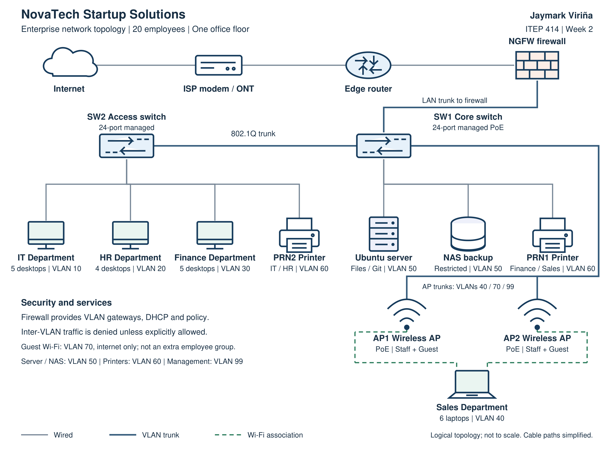

# Week 2 - Enterprise Infrastructure Planning

**Jaymark Viriña, BSIT**
ITEP 414 - System Administration and Maintenance

[Read the report](EnterpriseInfrastructurePlan.pdf) · [Read the text version](EnterpriseInfrastructurePlan.md) · [Diagram PDF](diagrams/NovaTech_Network_Diagram.pdf) · [Edit in Draw.io](diagrams/NovaTech_Network_Diagram.drawio)

## Project Overview

For Week 2, I planned the IT setup of **NovaTech Startup Solutions**, a fictional software startup with 20 employees. I took the role of a Junior System Administrator and chose the computers, software and network equipment the company would need. The report also covers staff access, backups and the IT roles responsible for keeping everything running.

## Learning Objectives

- Understand what the four system administration roles do and how they work together.
- Choose equipment and software based on the employees who will use them.
- Draw a network with clear connections and separate access for departments and guests.
- Explain the design through inventories, a report and GitHub documentation.

## Company Scenario

NovaTech has **20 employees on one office floor** in a fictional office in Calamba City, Laguna. It is starting from scratch, so computers, a server, internet access and security rules all need to be planned. Part 1 of the report contains the company profile and organizational structure.

| Department | Employees | Workstations |
| --- | --- | --- |
| Information Technology | 5 | 5 desktops |
| Human Resources | 4 | 4 desktops |
| Finance | 5 | 5 desktops |
| Sales | 6 | 6 laptops |
| Total | 20 | 14 desktops and 6 laptops |

## Hardware Inventory Summary

| Equipment | Quantity | Purpose |
| --- | --- | --- |
| Desktop computers | 14 | IT 5, HR 4, Finance 5 |
| Laptops | 6 | Sales mobility |
| Server / NAS | 1 each | Internal services / restricted local backups |
| Router / NGFW | 1 each | Provider routing / firewall and VPN |
| Managed switches | 2 | 24-port core SW1 and access SW2 |
| Wireless APs / printers | 2 each | Wi-Fi coverage / shared print and scan |
| UPS units | 3 | Infrastructure power protection |
| External backup drives | 2 | Encrypted rotation with one off-site |
| Monitors | 16 | 14 primary and two extra IT displays |

This is the equipment I would include in the initial setup. Part 2 explains the specifications and why each item is needed.

## Software Inventory Summary

| Software | Purpose / licensing approach |
| --- | --- |
| Windows 11 Pro | Business desktop OS, disk encryption and workstation administration. 20 OEM/device licenses. |
| Ubuntu Server | Server OS for Samba file shares, Git access, SSH and internal applications. [1,2] Open source. |
| Microsoft Office | Word, Excel, PowerPoint and Outlook; business email and collaboration. [3] 20 Business Premium user subscriptions. |
| VS Code | Code editing, debugging and development extensions for IT. Microsoft distribution license; no purchase fee. |
| Git | Version history and collaboration for application code and configuration. Open source (GPLv2). |
| GitHub Desktop | Graphical Git workflow for IT; private repository access follows company policy. Open source (MIT). |
| VirtualBox | Isolated development/test VMs on IT PCs. Optional Extension Pack excluded. [4] Open-source base package. |
| Google Chrome | Browser-based business services and web application compatibility tests. Proprietary; no purchase fee. |
| Microsoft Defender | Endpoint antivirus with centralized visibility using Defender for Business and Intune. [3] Built-in AV; business management via Premium. |
| AnyDesk | Authorized remote support by IT; no personal-use license for company support. [5] Paid commercial license. |
| 7-Zip | Archive and extract files for routine document and backup transfers. Open source; component licenses apply. |

Record the exact software builds when installing them. The budget needs separate Windows device licenses, Microsoft 365 user subscriptions and a commercial AnyDesk license. This plan uses the VirtualBox base package without the optional Extension Pack. See [sources 3-5](references/Sources.md).

## Network Inventory Summary

The design includes one ISP modem/ONT, one router, one firewall, two managed switches, two APs, one 24-port patch panel, 70 Cat6 cable items and 100 spare compatible RJ45 plugs. Cabling includes fixed runs, cabinet and endpoint leads, device interconnects and spares. See Part 4 for the itemized inventory and VLAN plan. SW1 uses 7 ports and SW2 uses 16; 25 ports remain unused across the two switches.

## Embedded Network Diagram

Internet → ISP modem/ONT → edge router → firewall → SW1 core switch. SW1 connects the server, NAS, one printer, two APs and SW2. SW2 connects the 14 desktops and second printer. Six Sales laptops use staff Wi-Fi. VLANs separate IT, HR, Finance, Sales, servers, printers, guests and device management; the firewall enforces access between them.

**Diagram files:** [PNG](diagrams/NovaTech_Network_Diagram.png), [PDF](diagrams/NovaTech_Network_Diagram.pdf), [editable Draw.io](diagrams/NovaTech_Network_Diagram.drawio), [SVG](diagrams/NovaTech_Network_Diagram.svg). Open the `.drawio` file in diagrams.net to edit individual symbols, labels and connectors.

## Technologies Used

The portfolio uses a Draw.io diagram, Markdown, Git/GitHub and a PDF report. The planned setup uses Windows 11 Pro, Ubuntu Server, VLANs, a VPN, NAS backups and centrally managed endpoint protection.

## Challenges Encountered

The network diagram took the most thought. I had to show where each device connects and check that the drawing matches the inventory. I also had to separate two questions: how a device connects to the network, and which resources it should be allowed to access. Counting ports, checking licenses and planning restores helped make the equipment list more useful.

## Reflection

I used to think that a System Administrator mainly fixes computers and installs software. Working on this plan for NovaTech showed me how much needs to be decided before any equipment is bought. The company has 20 employees, but their needs are different. The plan has to account for the work they do, the information they use, and what happens if a device or service fails.

The hardware inventory made those differences easier to understand. IT, HR, and Finance can use desktops because they mainly work at their desks. Sales needs laptops for work that may involve visiting clients. Shared equipment also needs a reason for being included. A NAS, backup drives, and UPS units may be less noticeable than computers, but they help protect the company's files and keep important services available.

The network diagram was the hardest part for me. Listing devices was straightforward; showing how they connect took more thought. The drawing also had to agree with the inventory. For example, the 14 desktops use wired connections, while the six Sales laptops use Wi-Fi. I needed to understand that connecting devices to a switch does not automatically mean every department should have access to the others. That is where the VLANs and firewall rules come in.

This activity also changed how I look at backups. Keeping another copy of a file is only part of the job. Someone still has to check whether the backup ran and whether the files can actually be restored. Software licenses and spare network ports also need attention early, since overlooking them can lead to extra costs after installation.

Planning gives the company something to check before spending money. It also gives the people setting up the network a clear starting point. For me, this project is practice in explaining my choices instead of just naming equipment. Learning about the helpdesk, network, Linux, and cloud roles showed me how their work connects during a problem. I still need hands-on experience configuring these systems, but I now have a better idea of what to check and document before deployment.

## References

The numbered citations in the report point to the sources used for IT roles, licensing, backups and password policy. The full list is in [references/Sources.md](references/Sources.md).

## Submission Checklist

- [x] Company profile and 20-person employee distribution
- [x] Hardware inventory with quantities and purposes
- [x] Software inventory with versions, licensing and purposes
- [x] Network inventory and VLAN plan
- [x] Labeled network diagram with student name in PNG and PDF
- [x] Four IT roles, certifications and collaboration paragraph
- [x] Seven infrastructure recommendation topics
- [x] Personal reflection within 300-500 words
- [x] README with headings, tables, image and working local links
- [ ] Publish the LinkedIn post and paste its permalink below
- [ ] Submit the required files or repository link in the LMS

**LinkedIn post:** Not published. The [draft](LinkedIn_Post_Draft.md) is saved with the project.

**LMS submission:** Not yet submitted.
