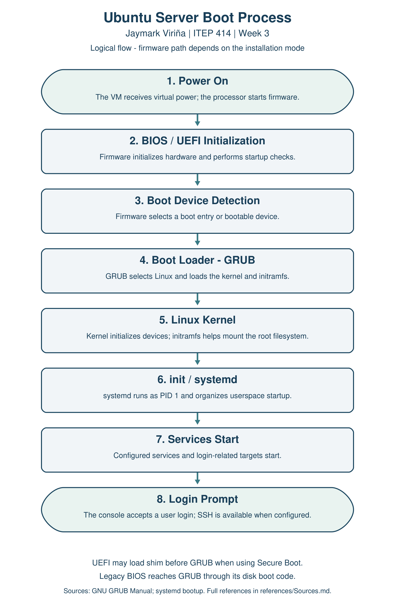

# Week 3 - Enterprise Server Deployment

**Jaymark Viriña, BSIT**

ITEP 414 - System Administration and Maintenance

**Status: guides and research prepared; actual VM installations and screenshot evidence pending.**

[Start here - Taglish](START_HERE_Taglish.md) | [Installation guide](InstallationGuide.pdf) | [Professional manual](ProfessionalInstallationManual.pdf) | [BIOS vs UEFI](BIOS_vs_UEFI.pdf) | [Boot flowchart](BootProcessFlowchart.pdf) | [Lab results](Lab_Results.md)

## Project Overview

This activity prepares a clean Ubuntu Server VM for the startup scenario. It covers installation, basic configuration, networking, updates and SSH. Windows Server Evaluation is a separate bring-home installation; Rocky Linux is researched for comparison. This folder currently provides the procedures and research. It does not yet prove a completed installation.

## Learning Objectives

- Install and configure a server OS in a virtual machine.
- Verify login, hostname, addressing, internet access, updates and SSH.
- Explain BIOS/UEFI and the stages of an Ubuntu boot.
- Compare Windows Server, Ubuntu Server and Rocky Linux.
- Keep a deployment record that another administrator can follow.

## Virtual Machine Specifications

| Setting | Planned value |
| --- | --- |
| VM name | Ubuntu-Server-Week03 |
| Operating system | Ubuntu Server 26.04.1 LTS, amd64 / 64-bit [1] |
| Memory | 4096 MB (4 GB) |
| Processors | 2 virtual CPUs |
| Disk | 40 GB dynamically allocated VDI |
| Networking | Adapter 1: NAT; cable connected; DHCP |
| Firmware | UEFI enabled before installation; record actual mode |
| Hostname / user | server01 / virina (non-root administrative account) |
| Keyboard / storage | English (US); guided entire virtual disk; no LVM for this guide |
| SSH / extra packages | Install OpenSSH Server; leave optional server snaps unselected |

Windows lab recommendation: separate Windows-Server-Week03 VM, 4 GB RAM, 2 CPUs, 80 GB dynamic disk and NAT. Use the official Windows Server 2025 Evaluation image and check its hardware requirements [12,14].

## Installation Summary

The guide follows English / US keyboard, DHCP, guided entire-disk storage, server01, the virina sudo account and OpenSSH installation. Optional server snaps are left unselected. These are target settings; the VM has not been installed or observed through this repository yet. Record the actual ISO/build, layout and install date in [Lab_Results.md](Lab_Results.md).

## Configuration Summary

NAT is the classroom baseline. For host-to-guest SSH, forward TCP 127.0.0.1:2222 on the Windows host to guest port 22. Keep the guest IP blank in VirtualBox's NAT forwarding rule. Then use `ssh -p 2222 virina@127.0.0.1`. Check the guest's public host-key fingerprint before trusting the first connection [4,5].

The lab uses UEFI before installation. Confirm the actual boot mode, partition table and filesystems afterward instead of assuming them. No web/database/file-sharing services are installed in this clean OS activity.

## Verification Results

All checks below await execution on the actual Ubuntu VM. Expected results are described in the guide, not presented as successful test output.

| Task | Command | Current result |
| --- | --- | --- |
| Login | `whoami` | Not run; screenshot pending |
| Hostname | `hostname` | Not run; screenshot pending |
| IP address | `ip addr` | Not run; screenshot pending |
| Connectivity | `ping -c 4 google.com` | Not run; screenshot pending |
| Package index | `sudo apt update` | Not run; screenshot pending |
| Upgrades | `sudo apt upgrade -y` | Not run; screenshot pending |
| SSH service | `systemctl status ssh` | Not run; screenshot pending |

If SSH uses socket activation, inspect `ssh.socket`, make a connection or start `ssh`, then capture the real service state. A successful SSH login still needs its own test. The optional [verification helper](scripts/verify-server.sh) only collects local observations; it does not install or update anything.

## BIOS vs UEFI Highlights

UEFI uses EFI boot programs and is commonly paired with GPT. Legacy BIOS usually uses a disk boot-code path. The familiar MBR limit is about 2 TiB with 512-byte sectors; firmware mode and partition style should not be treated as the same setting. Secure Boot verifies trusted boot components only when it is supported and enabled [7-9]. See the [comparison and one-page explanation](BIOS_vs_UEFI.pdf).

## Embedded Boot Process Flowchart

[PDF](BootProcessFlowchart.pdf) | [Editable Draw.io](diagrams/BootProcessFlowchart.drawio) | [SVG](diagrams/BootProcessFlowchart.svg)

The eight stages are Power On, BIOS/UEFI Initialization, Boot Device Detection, GRUB, Linux Kernel, init/systemd, Services Start and Login Prompt [10,11].

## Windows Server and OS Comparison

Windows installation remains pending. The [installation guide](InstallationGuide.pdf) includes its procedure, a comparison table and a one-page discussion. An [editable text comparison](OS_Comparison.md) is also included. No Rocky Linux installation or performance benchmark is claimed.

## Challenges Encountered

No real installation problems have been reported yet. The [troubleshooting section](ProfessionalInstallationManual.md) explains possible issues such as no DHCP address, an attached ISO after reboot and SSH port forwarding. Actual problems and fixes belong in [Lab_Results.md](Lab_Results.md) after testing.

## Reflection

*Preparation reflection, 352 words. Review and update this after completing the VM lab.*

Preparing this deployment project helped me connect the operating system lessons to the work of a System Administrator. In Week 2, I focused on choosing equipment and planning a network. This activity moves closer to using that plan because a server needs an installed and configured operating system before it can provide any service.

The VM settings made me think about the host computer as well as the guest. Giving a server more RAM is not always helpful if the laptop running it no longer has enough memory. The separate Ubuntu and Windows VMs also make the comparison clearer. Each installation needs its own disk, account settings and verification record.

The BIOS and UEFI comparison was useful because firmware, partition style and the operating system are connected, but they are not the same thing. I learned why it is better to record the firmware mode before installation. I also need to check the actual partitions instead of writing down a layout just because it appears in an example.

Another important point is the difference between an expected result and a result that has been tested. A command such as hostname has a clear purpose, but writing the command in a guide does not prove that server01 is configured. The same applies to internet access, updates and SSH. Those checks need to be run on the VM and supported by readable screenshots.

Planning the SSH test helped me understand NAT better. The guest can access the internet, but a connection from the Windows host needs a forwarding rule. Keeping that rule on the host's loopback address gives this local exercise a limited access path. I also understand why passwords should stay out of screenshots and the repository.

At this stage, the guides and research are prepared, while the installations and verification are still to be completed. After the lab, I will revise this reflection using the problems I actually encountered and the steps that solved them. The main lesson so far is that useful documentation should help another person repeat the work and should clearly show what has and has not been verified.

## References

Numbered references point to [references/Sources.md](references/Sources.md). The lab settings and required outputs follow the supplied Week 3 assignment.

## Completion Checklist

- [x] Installation guide and professional manual prepared
- [x] BIOS vs UEFI table and one-page explanation prepared
- [x] Eight-stage boot flowchart in PNG, PDF and editable Draw.io
- [x] Windows/Ubuntu/Rocky comparison table and discussion prepared
- [x] README, verification helper and screenshot checklist prepared
- [ ] Ubuntu installed and required settings recorded
- [ ] Required verification commands run with real evidence
- [ ] Host-to-guest SSH login demonstrated
- [ ] Windows Server Evaluation installed, named and logged into
- [ ] Real screenshots embedded in the guides and README
- [ ] Reflection revised after the lab
- [ ] LMS submission completed
- [ ] LinkedIn task completed if proceeding with that requirement

No LinkedIn post or LMS submission has been made.
